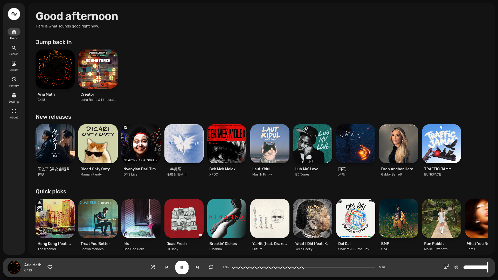
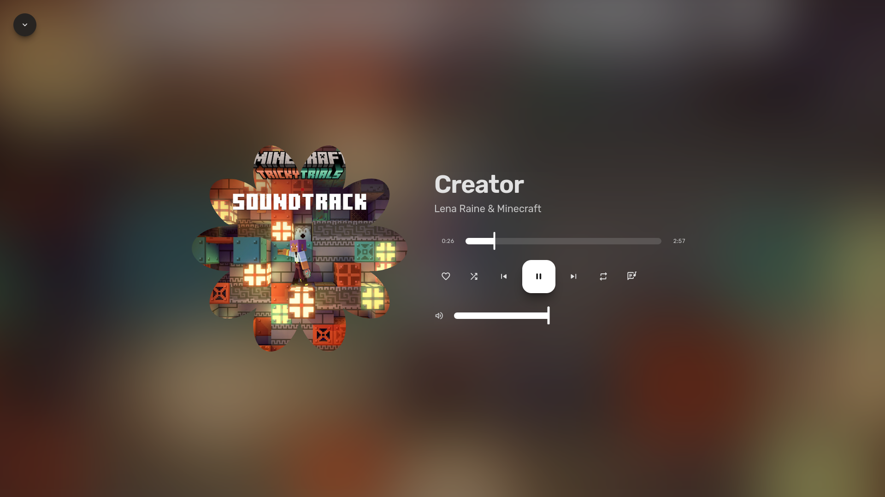

<div align="center">

<h1>Melissm</h1>
<p>It plays music, literally. What else would it do?</p>
<p>A music app for Arch Linux with streaming, synced lyrics, and a Material 3 Expressive UI that themes itself from your wallpaper.</p>
</div>
<p align="center">
  <a href="https://github.com/rynekryz/melissm/stargazers"></a>
  <a href="https://github.com/rynekryz/melissm/tags"></a>
  <a href="LICENSE"></a>
  
  
  
</p>

<p align="center">
  <a href="https://github.com/rynekryz/melissm/releases"></a>
</p>

---

## Screenshots

<div align="center">


</div>

---

## Features

- Tauri v2 + Rust backend, no Electron and no bundled Chromium, your RAM is safe here
- Streams audio straight from YouTube Music, no video overhead, the GPU can chill
- Live Material 3 Expressive theming from your wallpaper via Matugen, or any color you like
- Caelestia scheme fallback when wallpaper extraction gives up
- MPRIS controls, so it shows up in your media widget with lyrics
- Search, Home, Album, Artist, Playlist, Library and History
- Native queue: play next, add to queue, reorder, radio, clear upcoming
- Gapless playback and optional crossfade
- Playlists, liked songs and history stored locally
- Synced lyrics from LRCLIB with word-by-word timing, NetEase as backup
- Write your own lyrics or fix the timing with an offset, fullscreen too
- Tray controls, so you can pause when the boss walks by
- Speed, pitch, equalizer and audio quality
- Played songs get cached for instant replay
- Single instance, clicking again just focuses the window
- Material Web Components + Tailwind CSS 4
- Desktop entry and GTK app id so your launcher knows it exists
- It plays music, literally
- etc.

---

## Technical Stack

- **Shell:** Astro with Tauri v2 (Rust)
- **UI:** Material Web Components and Tailwind CSS 4
- **Playback:** GStreamer
- **Database:** SQLite through rusqlite
- **Network:** reqwest
- **Theming:** Matugen
- **Language:** TypeScript, Astro and Rust
- **Build:** npm, Cargo and a PKGBUILD

---

## Building

You'll need Arch Linux (or an Arch-based distro, you know who you are) and Git.

### From the PKGBUILD

```bash
git clone https://github.com/rynekryz/melissm.git
cd melissm
makepkg -si
```

### From source

```bash
sudo pacman -S --needed webkit2gtk-4.1 base-devel curl wget file openssl appmenu-gtk-module libappindicator-gtk3 librsvg alsa-lib nodejs npm rust matugen gstreamer gst-plugins-good gst-plugins-bad gst-libav
git clone https://github.com/rynekryz/melissm.git
cd melissm
npm install
npm run tauri dev
npm run tauri build
```

---

## Project Structure

```
Melissm/
├── src/
│   ├── components/
│   ├── layouts/
│   ├── lib/
│   ├── pages/
│   └── styles/
├── src-tauri/
│   └── src/
├── icons/
├── public/
└── PKGBUILD
```

---

## Legal

Melissm is an independent open-source music player, not affiliated with or endorsed by YouTube or Google LLC. All trademarks belong to their owners. It doesn't host or distribute any media; playback streams straight from YouTube Music.

## Credits

Extractor approach and lyrics provider design from [Metrolist](https://github.com/MetrolistGroup/Metrolist). See [THIRD_PARTY_NOTICES.md](THIRD_PARTY_NOTICES.md) for the full list.

## License

Licensed under GPL-3.0-or-later. See [LICENSE](LICENSE).

<div align="center">
<strong>Made with ♥︎ by Ryne</strong>
</div>
<div align="center">
  <a href="https://discord.gg/YKhWXXhKmC"></a>
  <a href="https://tiktok.com/@rynekryz"></a>
</div>
