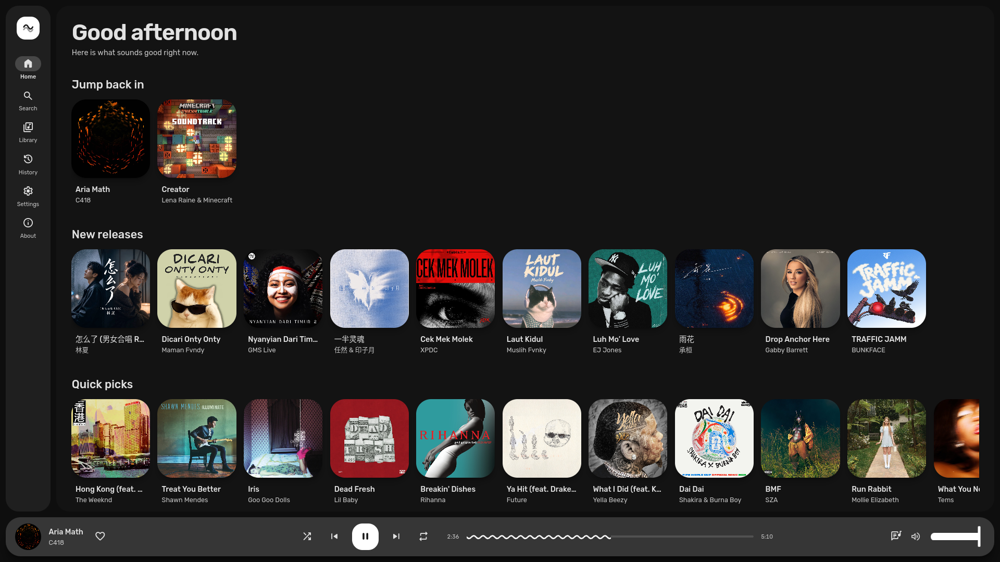
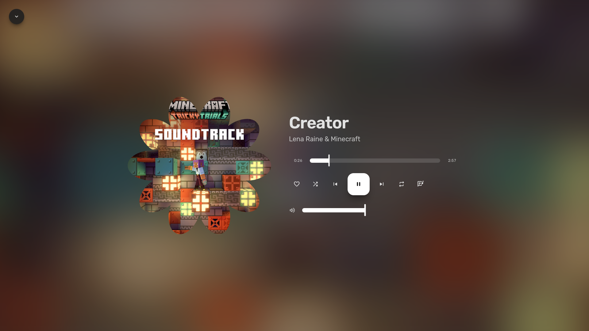

<div align="center">

<h1>Melissm</h1>
<p>It plays music, literally. what else would it do</p>
<p>A music streaming app for Arch Linux. Astro + Tauri v2 (Rust), GStreamer playback, Material 3 Expressive UI themed live from your wallpaper via Matugen (falls back to Caelestia's scheme).</p>
</div>
<p align="center">
  <a href="https://github.com/rynekryz/melissm/stargazers"></a>
  <a href="https://github.com/rynekryz/melissm/tags"></a>
  <a href="LICENSE"></a>
  
  
  
</p>

## Screenshots

<div align="center">


</div>

## Installing

### Requirements
- Arch Linux or an Arch-based distro (you know who you are)
- Git

### Install from PKGBUILD
```bash
git clone https://github.com/rynekryz/melissm.git
cd melissm
makepkg -si
```

### Build from source
Install deps:
```bash
sudo pacman -S --needed webkit2gtk-4.1 base-devel curl wget file openssl appmenu-gtk-module libappindicator-gtk3 librsvg alsa-lib nodejs npm rust matugen gstreamer gst-plugins-good gst-plugins-bad gst-libav
```

Then:
```bash
git clone https://github.com/rynekryz/melissm.git
cd melissm
npm install
npm run tauri dev
npm run tauri build
```

## Features

- Tauri v2 + Rust backend, no Electron, no bundled Chromium, your RAM is safe here
- Streams audio straight from YouTube Music, no video overhead, the GPU can chill
- Live Material 3 Expressive theming from your wallpaper via Matugen
- Caelestia scheme fallback when wallpaper extraction doesn't work out
- MPRIS media controls, shows up in your system media widget with lyrics
- Search, Home, Album, Library and History
- Synced lyrics panel via LrcLib, slides in like it's cool
- System tray with playback controls, so you can pause when the boss walks by
- Play / pause / resume / seek / volume
- Material Web Components + Tailwind CSS 4
- Desktop entry and GTK app id so your app launcher actually knows it exists
- It plays music, literally
- etc.

## Credits

Extractor approach and lyrics provider design from [Metrolist](https://github.com/MetrolistGroup/Metrolist). See [THIRD_PARTY_NOTICES.md](THIRD_PARTY_NOTICES.md) for the full list.

## License

Licensed under GPL-3.0-or-later. See [LICENSE](LICENSE) for details.

<div align="center">
<strong>Made with ♥︎ by Ryne</strong>
</div>
<div align="center">
  <a href="https://discord.gg/YKhWXXhKmC"></a>
  <a href="https://tiktok.com/@rynekryz"></a>
</div>
